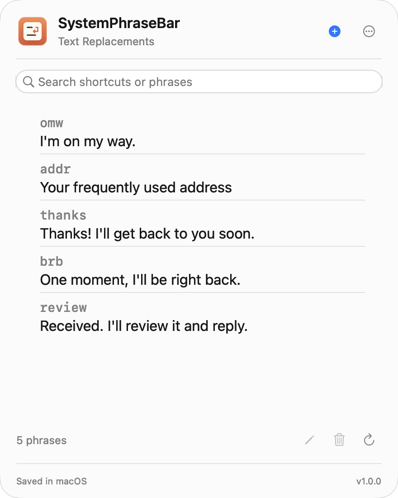

# SystemPhraseBar

A small menu bar app for the Text Replacements built into macOS.

[简体中文说明](README.zh-CN.md)

## Download

[Download for macOS](https://github.com/f-is-h/SystemPhraseBar/releases/latest)

Unzip, move **SystemPhraseBar.app** to Applications, and open it. No installer.



## Use

Left- or right-click the menu bar icon to manage phrases. Open settings and About from the `…` button inside the panel.

Includes Liquid Glass, automatic Chinese/English selection, launch at login, update checks, and the 20 most recent local backups. macOS handles text expansion and iCloud sync.

## Notes

- macOS 14+, Apple Silicon and Intel. Liquid Glass requires macOS 26+; tested on Apple Silicon / macOS 27.
- Ad-hoc signed, not notarized. If blocked, review the app and use **System Settings → Privacy & Security → Open Anyway**.
- Uses an undocumented system phrase service; compatibility may change with macOS updates.

## Build

Requires a macOS 26+ SDK. No third-party dependencies.

```sh
zsh scripts/build.sh
```

[Development and backups](docs/DEVELOPMENT.md) · [MIT license](LICENSE)
