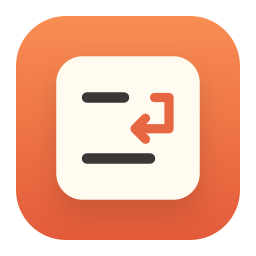
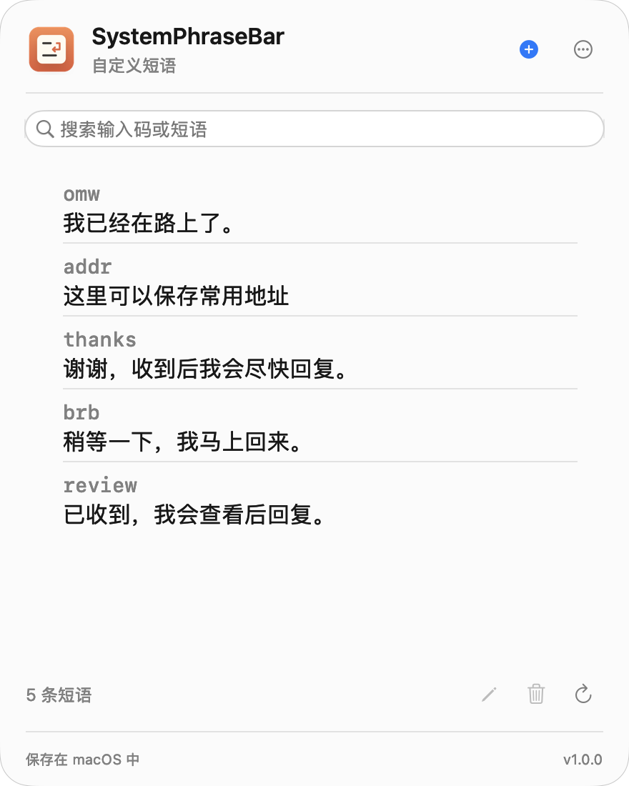

# SystemPhraseBar

在菜单栏管理 macOS 自带的自定义短语。

[English](README.md)

## 下载

[下载 macOS 版](https://github.com/f-is-h/SystemPhraseBar/releases/latest)

解压，把 **SystemPhraseBar.app** 放入「应用程序」，双击打开，无需安装器。



## 使用

左键或右键点击菜单栏图标，打开短语列表；设置和「关于」从面板内的 `…` 打开。

支持 Liquid Glass、自动中英文、登录启动和更新检查，自动保留最近 20 份本地备份。文字展开与 iCloud 同步由 macOS 处理。

## 说明

- macOS 14+，包含 Apple Silicon 和 Intel。Liquid Glass 需要 macOS 26+；已在 Apple Silicon / macOS 27 验证。
- ad-hoc 签名，未经 Apple 公证。若被拦截，请检查来源后在「系统设置 → 隐私与安全性」中选择「仍要打开」。
- 使用未公开的系统短语接口，后续 macOS 更新可能需要适配。

## 构建

需要 macOS 26+ SDK，没有第三方依赖。

```sh
zsh scripts/build.sh
```

[开发与备份说明（英文）](docs/DEVELOPMENT.md) · [MIT 许可证](LICENSE)
